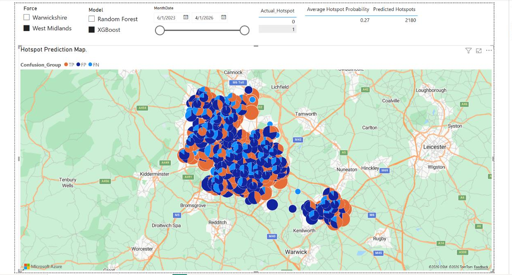

# Explainable Crime Hotspot Prediction (MSc Dissertation)

Predicting which local areas will become crime hotspots next month, explaining why, and presenting the results in a Power BI dashboard for non-technical users.

**MSc Data Analytics (Distinction), De Montfort University (2026)** · Supervisor: Dr Waddah Saeed

<!-- Add your Power BI screenshots: dashboard_map.png, dashboard_overview.png, dashboard_performance.png -->

## Key findings
- **Recent history predicts hotspots best.** An area's average crime over the previous 3 months was the strongest feature in all four models (SHAP).
- **Random Forest gave the best F1 in both forces:** 80.7% in Warwickshire and 72.7% in West Midlands, with ROC-AUC between 0.93 and 0.97 on unseen future months.
- **There is a clear precision vs recall trade-off.** In West Midlands, XGBoost caught 169 more true hotspots than Random Forest but produced 2.1× as many false alarms.
- **Explanations can disagree.** SHAP and LIME top-5 feature agreement (Jaccard) ranged from 0.285 to 0.792 depending on model and area, so accurate predictions do not guarantee stable explanations.

## Data
- [UK Police open data](https://data.police.uk), street-level crime for **West Midlands** (urban) and **Warwickshire** (more rural)
- June 2023 to April 2026, 35 months, **70 CSV files, 1,121,393 records**

## Data cleaning

| Step | Removed | Remaining |
|---|---:|---:|
| Raw archive (70 CSV files) | – | 1,121,393 |
| Missing coordinates | 1,235 | 1,120,158 |
| Outside study-area bounds | 360 | 1,119,798 |
| LSOA code and name check | 0 | 1,119,798 |
| Duplicate non-null Crime IDs | 11 | 1,119,787 |

The cleaned records were aggregated into an **LSOA-month panel**: 2,711 areas (1,760 West Midlands, 951 Warwickshire), 94,885 rows, and 86,752 model-ready rows after a 3-month lag warm-up.

## Approach
1. **Hotspot label:** an area-month is a hotspot if its crime count is in the top 20% for that force and month, so the urban force does not dominate.
2. **Features (25):** lagged counts (1–3 months), 3-month mean and standard deviation, previous hotspot status, previous-month count for each of 14 offence types, location and seasonal time features.
3. **Chronological split**, so models are always tested on future months:

   | Period | Months |
   |---|---|
   | Train | Sep 2023 – Jun 2025 (22) |
   | Validation | Jul 2025 – Nov 2025 (5) |
   | Test | Dec 2025 – Apr 2026 (5) |

4. **Models:** Random Forest (balanced class weights) and XGBoost (`scale_pos_weight`), tuned on validation F1, then refit and scored once on the test months.
5. **Explainability:** SHAP for global and local attributions, LIME for selected cases, compared with Jaccard overlap.
6. **Power BI:** a three-page dashboard (overview, hotspot map, model performance) built from one exported master dataset.

## Results (test period)

| Force | Model | Precision | Recall | F1 | ROC-AUC | PR-AUC |
|---|---|---:|---:|---:|---:|---:|
| Warwickshire | Random Forest | 81.28 | 80.20 | **80.74** | **97.30** | 89.87 |
| Warwickshire | XGBoost | 76.07 | 84.87 | 80.23 | 97.15 | 89.42 |
| West Midlands | Random Forest | 77.39 | 68.54 | **72.70** | 93.73 | 83.75 |
| West Midlands | XGBoost | 65.23 | 77.79 | 70.96 | 92.99 | 81.87 |

## Limitations
Recorded crime only (reflects reporting and enforcement), approximate anonymised locations, no contextual data such as population or deprivation, and the dashboard is a prototype that has not been user-tested.

## Tools
Python (pandas, scikit-learn, XGBoost, SHAP, LIME, Matplotlib), Power BI

## Repository contents
<!-- Update to match the files you upload -->
| File | Description |
|---|---|
| `notebooks/` | Data cleaning, feature engineering, modelling and explainability |
| `dashboard_*.png` | Power BI dashboard screenshots |

## Author
**Affan Ahmad Khan** · [LinkedIn](https://www.linkedin.com/in/affanahmad66/)
